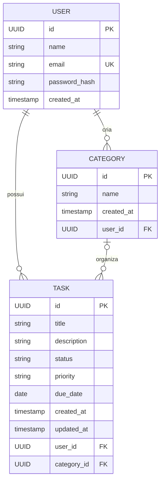

# TaskFlow - Modelo de Domínio

## 1. Objetivo

Definir as entidades, atributos, relacionamentos e restrições do TaskFlow, conforme os requisitos e regras de negócio do MVP.

## 2. Entidades

### User
- id: UUID, chave primária
- name: String, obrigatório
- email: String, obrigatório e único
- passwordHash: String, obrigatório
- createdAt: Instant, obrigatório

### Task
- id: UUID, chave primária
- title: String, obrigatório
- description: String, opcional
- status: TaskStatus, obrigatório, padrão PENDING
- priority: TaskPriority, obrigatório, padrão MEDIUM
- dueDate: LocalDate, opcional
- createdAt: Instant, obrigatório
- updatedAt: Instant, obrigatório
- user: User, obrigatório
- category: Category, opcional

### Category
- id: UUID, chave primária
- name: String, obrigatório
- createdAt: Instant, obrigatório
- user: User, obrigatório

## 3. Enumerações

TaskStatus:
- PENDING
- IN_PROGRESS
- COMPLETED

TaskPriority:
- LOW
- MEDIUM
- HIGH

## 4. Relacionamentos

- User 1:N Task
- User 1:N Category
- Category 1:N Task, com categoria opcional na tarefa

## 5. Restrições de integridade

- O e-mail do usuário deve ser único.
- O título da tarefa não pode ser vazio.
- Títulos de tarefas podem ser repetidos.
- Uma tarefa pertence a exatamente um usuário.
- Uma categoria pertence a exatamente um usuário.
- Uma tarefa só pode utilizar uma categoria do próprio usuário.
- Ao excluir uma categoria, suas tarefas permanecem sem categoria.
- A exclusão de um usuário e o tratamento dos seus dados associados serão definidos antes da implementação.

## 6. Diagrama ER

## 7. Regras relacionadas

- RN-001: reabertura de tarefas
- RN-002: categoria e prazo opcionais
- RN-003: prazos anteriores à data atual
- RN-004: exclusão de categorias sem excluir tarefas
- RN-005: títulos duplicados
- RN-006: exclusão de tarefas concluídas
- RG-001: isolamento de dados
- RG-004: integridade dos relacionamentos

## 8. Critérios de aceitação

- [x] Entidades identificadas.
- [x] Atributos definidos.
- [x] Relacionamentos documentados.
- [x] Restrições de integridade especificadas.
- [x] Diagrama entidade-relacionamento elaborado.
- [ ] Documento revisado e integrado à main.
